# Introdução
## Aluguel em São Paulo

## Aluguel em São Paulo

Para entender o preço do aluguel em São Paulo, temos um dataset com características de apartamentos e o preço do aluguel de cada um.

preço $\sim$ area + quartos + garagem ... 

## Aluguel em São Paulo

## Aluguel em São Paulo

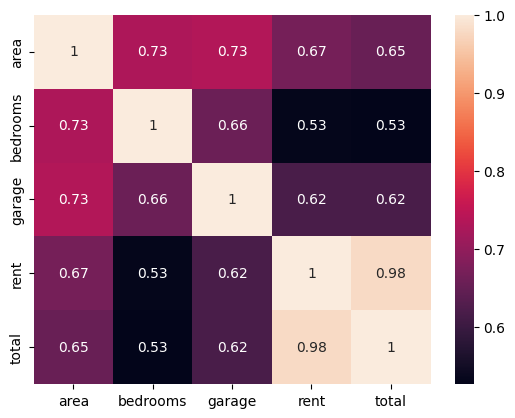{ width=250px }

## Aluguel em São Paulo

Ajustamos um modelo linear $y_i=X_i\beta + \epsilon_i, \forall i$ e encontramos coeficientes $\beta$ que indicam como cada covariável influencia no preço final.

| Statistic           | Value                |
| :------------------ | :------------------- |
| Dep. Variable       | $\log$ rent            |
| Model               | OLS                  |
| No. Observations | 11657 |
| R-squared           | 0.563                |
| Prob (F-statistic)  | 0.00                 |

| Term               | coef    | std err | t         | $P>|t|$ | 
| :----------------- | :------ | :------ | :-------- | :------ |
| const              | 7.2700  | 0.006   | 1124.248  | 0.000   | 
| area               | 0.0057  | 0.000   | 54.590    | 0.000   |
| ... | ... | ...   | ...    | ...   |

Os coeficientes encontrados possuem p-valor baixo. O modelo é confiável?

## Aluguel em São Paulo

Para checar a eficiência do modelo, vamos fazer um teste: prever o preço de um Loft em Pinheiros. O imóvel possui 1 quarto, 0 garagens, $20m^2$ de área, etc.

Identificamos imediatamente que o aluguel é caro. Mas ao contar apenas as características do imóvel, o modelo não consegue quantificar o preço do aluguel corretamente.

## Aluguel em São Paulo

Devemos considerar a espacialidade no modelo!

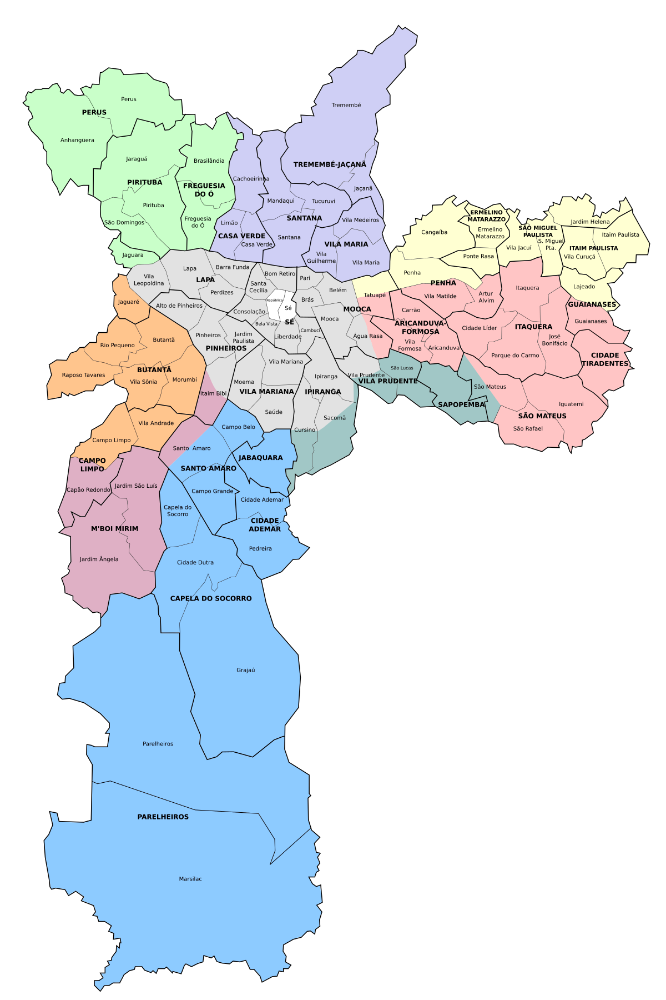

## Primeira Lei da Geografia

> "Tudo é correlacionado. Mas certas coisas são mais correlacionadas que outras" 

Waldo Tobler

## Primeira Lei da Geografia

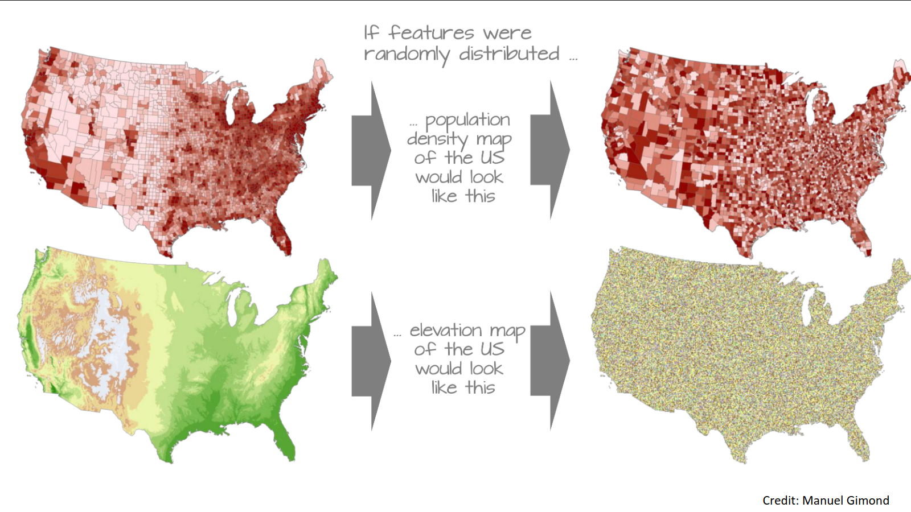

# Espacialidade
## Spatial Autoregressive Model

O valor do aluguel de uma apartamento em São Paulo depende das covariáveis e também do preço dos apartamentos vizinhos.

$y_i = \sum_{j \in \text{vizinhos}}y_j w_{ij} + X_i\beta + \epsilon_i$

Nesse modelos, os termos $w_{ij}$ representam a relação entre as amostras $i$ e $j$.

## Spatial Autoregressive Model
### Teste $I$ de Moran

Como saber se meus dados são espacialmente correlacionados?

$$
I = \dfrac{N}{\sum_{i,j} W_{ij}} \dfrac{y^T W y}{y^T y}
$$

Sob a hipótese nula de **não correlação espacial**, o valor esperado de $I$ é

$$
E(I)=\dfrac{-1}{N-1}
$$

Isso significa que para muitas amostras, o valor esperado tende a 0.

## Spatial Autoregressive Model

Para encontrar os termos $w_{ij}$ podemos utilizar a matriz de adjacências de um grafo. Para o caso do aluguel em São Paulo, podemos considerar a distância entre as casas para montar a Matriz de Adjacências.

$$
w_{ij}=
\begin{cases}
1, d(i, j) < c \\
0, c.c.
\end{cases}
$$

## Spatial Autoregressive Model

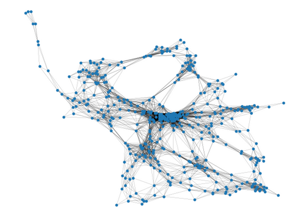{ width=250px }

## Spatial Autoregressive

Mais especificamente, os modelos costumam utilizar uma versão normalizada da matriz de adjacências. Nela, o valor de cada arestas é normalizado de acordo com o número de conexões dos nós. Essa matriz tem propriedades interessantes que vamos considerar.

$W_{\text{norm}} = D^{-1/2}WD^{-1/2}$

## Spatial Autoregressive Model

O termo $y$ aparece em ambos lados da equação (por isso é Autoregressivo, afinal). Como encontrar estimar $\beta$? 

Primeiro escrevemos na forma matricial. 

$Y=WY +X\beta + \epsilon$

Então, uma simples manipulação permite resolver. 

$Y - WY=X\beta + \epsilon$

$Y(I - W)=X\beta + \epsilon$

$Y=(I - W)^{-1}(X\beta + \epsilon)$

Portanto, basta multiplicar $X$ pelo termo $(I - W)^{-1}$ e resolver o sistema linear resultante.

## Efeito do operador $(I - \rho W)^{-1}$ 

Para visualizar o efeito, vamos considerar a aplicação do operador sobre um vetor $X=[1,0,0,...,0,0,-1]$ que possui matriz de adjacência normalizada $W$. 

Consideramos um termo $\rho$ que permite regularizar a relação.

## Efeito do operador $(I - \rho W)^{-1}$ 
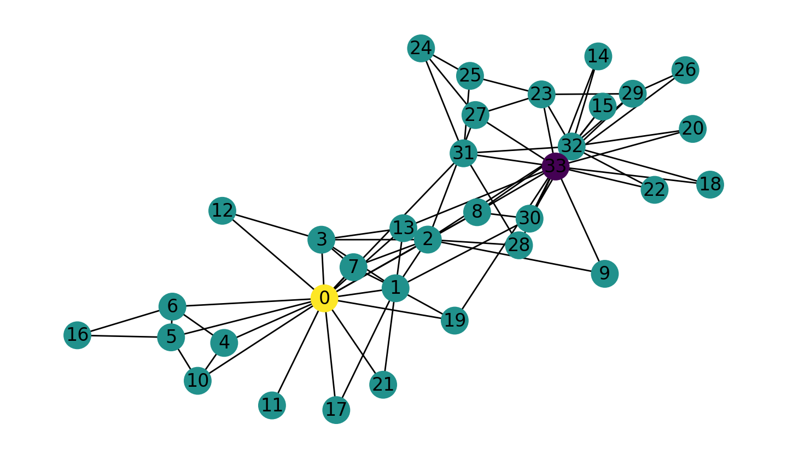

## Efeito do operador $(I - \rho W)^{-1}$ 
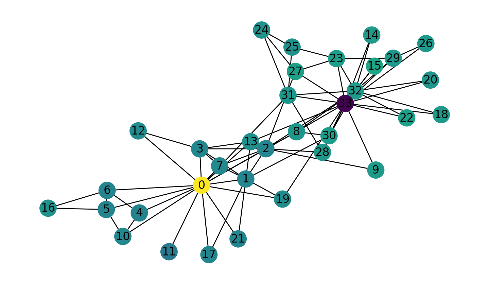

## Efeito do operador $(I - \rho W)^{-1}$ 
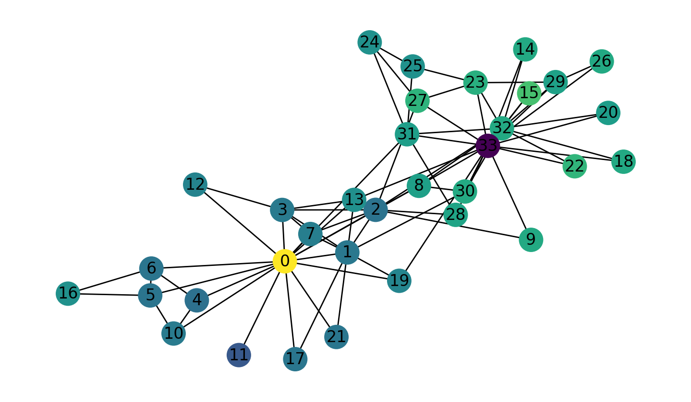

## Efeito do operador $(I - \rho W)^{-1}$ 
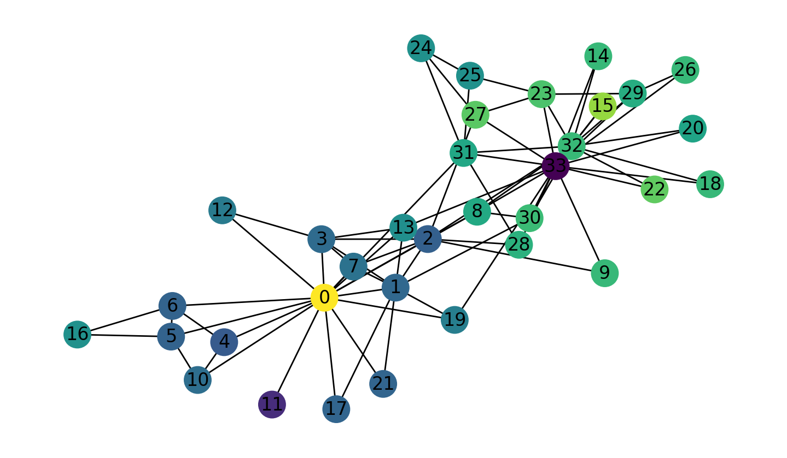

## Efeito do operador $(I - \rho W)^{-1}$ 
Esperávamos que os vizinhos dos nós 0 e 33 recebessem valor similar, porém isso não aconteceu! 

## Uma outra visão sobre Modelos Espaciais

- Enquanto os Modelos Lineares foram desenvolvidos, a área de Deep Learning também se desenvolveu. 
- CNNs são ferramentas poderosíssimas para lidar com imagens. O princípio de funcionamento de uma CNN é aplicar convoluções sobre a imagem e entender o resultado final. 
- A Convolução é uma operação que faz a média dos pixels em uma área, gerando um efeito de *blur*.

## Uma outra visão sobre Modelos Espaciais

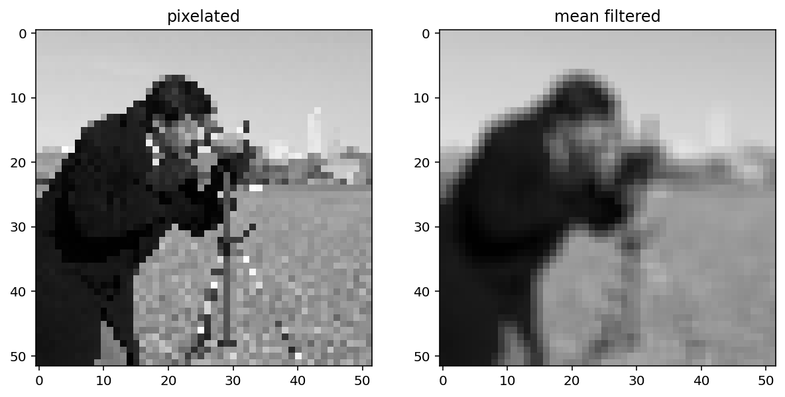

## Uma outra visão sobre Modelos Espaciais

- Baseado em CNNs, os cientistas desenvolveram GCNs, que seguem o mesmo princípio de convolução, porém para dados estruturados por grafos.

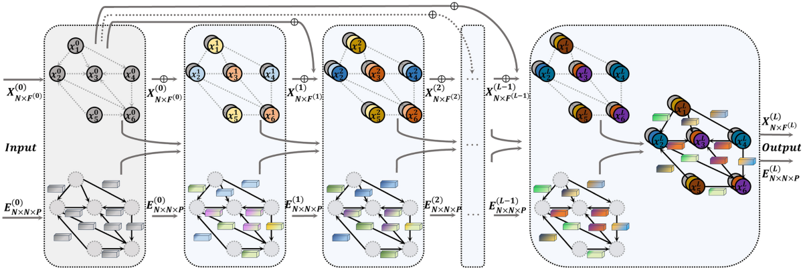

## Uma outra visão sobre Modelos Espaciais
- Podemos aplicar uma GCN para estimar o preço do aluguel em SP?
- Certamente, porém vamos perder explicabilidade sobre as covariáveis devido ao número de camadas não lineares. O que fazer?

## Uma outra visão sobre Modelos Espaciais

Retiramos as não linearidades! Assim, obtemos um Modelo Linear que faz a convolução das covariáveis.

$Y=\exp(-t L)X\beta$

Onde $L$ é a matriz Laplaciana e $\exp(-t L)$ representa a difusão ao longo do tempo $t$.

Para fins numéricos, a **matriz Laplaciana normalizada** é tradicionalmente utilizada: $L=I-W$, onde $W$ é a matriz de adjacências normalizada.

## Efeito do operador de difusão 

## Efeito do operador de difusão 
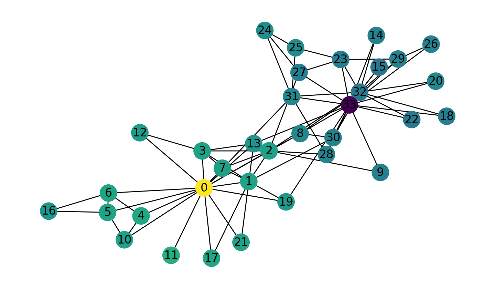

## Efeito do operador de difusão 
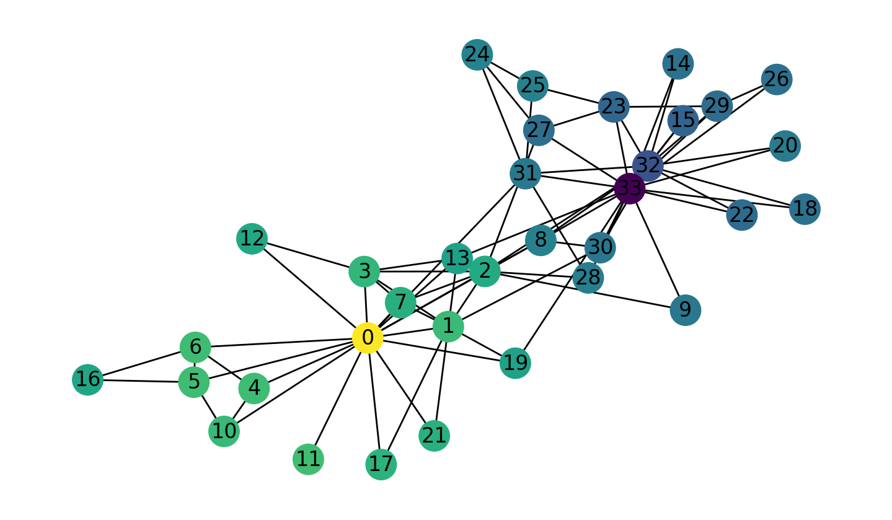

## Efeito do operador de difusão 
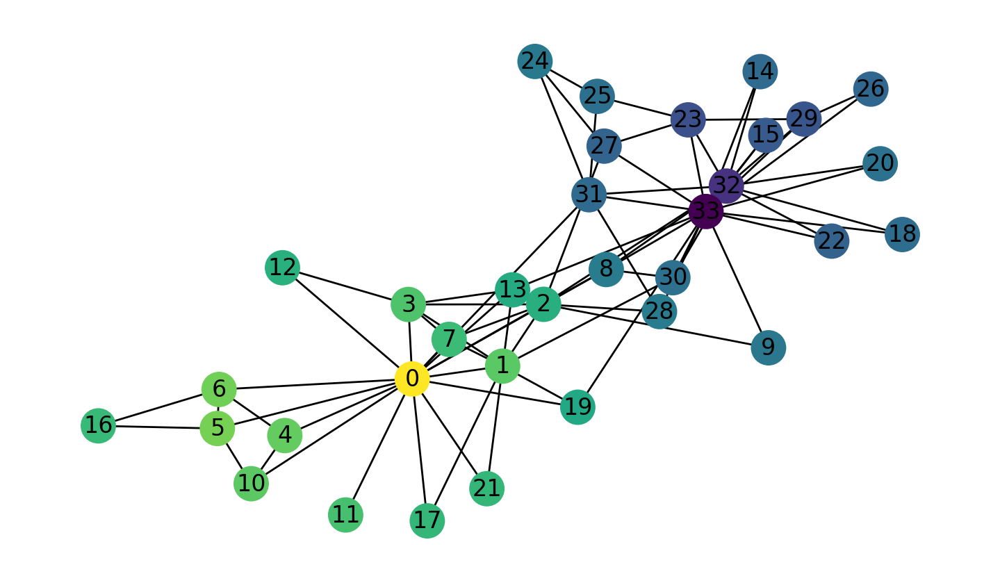

## Efeito do operador de difusão 
A difusão em grafos tem um efeito parecido com o *blur* na imagem. De fato, é a mesma operação.

Os operadores apresentados podem ser interpretados como filtros sobre os dados.
Fazemos a transformação para o domínio espectral e retiramos frequências indesejadas. 
Normalmente, frequências mais altas representam ruídos e assim, é importante filtrá-las.

## Equivalência entre os Operadores

### Série Geométrica para Matrizes
$$\sum_{k=0}^{\infty} A^k = (I - A)^{-1}$$

### Série de Maclaurin para Matrizes

$$e^A = \sum_{k=0}^{\infty} \frac{A^k}{k!} = I + A + \frac{A^2}{2!} + \frac{A^3}{3!} + \dots$$

## Equivalência entre os Operadores
Utilizando as séries, podemos escrever 

$exp(-tL) = I - tL + \frac{t^2L^2}{2!} + \frac{t^3L^3}{3!} + \dots$

Para $t \rightarrow 0$, podemos aproximar a série com

$exp(-tL) \approx I - tL$

Lembrando que a Laplaciana normalizada é $L=I-W$, temos:

$exp(-tL) \approx I - t(I-W) = I - tI + tW$

## Equivalência entre os Operadores
Por outro lado, também podemos reescrever o operador de Autoregressão Espacial utilizando a série geométrica

$(I - \rho W)^{-1} = I + \rho W + (\rho W)^2 + \dots$

Para valores pequenos de $\rho$, aproximamos como

$(I - \rho W)^{-1} \approx I + \rho W$

Vemos que a menos de um termo $tI$, para $\rho=t \rightarrow 0$, a regressão autoespacial é uma aproximação linear da difusão

$exp(-tL) \approx (I-\rho W)^{-1}$

# Resultados
## Sumário da Regressão para Modelo Linear
| Statistic           | Value                |
| :------------------ | :------------------- |
| Dep. Variable       | $\log$ rent            |
| Model               | OLS                  |
| No. Observations | 11657 |
| R-squared           | 0.563                |
| Prob (F-statistic)  | 0.00                 |

| Term               | coef    | std err | t         | $P>|t|$ | 
| :----------------- | :------ | :------ | :-------- | :------ |
| const              | 7.2700  | 0.006   | 1124.248  | 0.000   | 
| area               | 0.0057  | 0.000   | 54.590    | 0.000   |
| garage             | 0.2150  | 0.006   | 36.296    | 0.000   |
| Casa               | -0.3856 | 0.010   | -39.078   | 0.000   |
| Casa em condomínio | -0.2718 | 0.027   | -10.202   | 0.000   |

## Sumário da Regressão para Modelo Linear

## Sumário da Regressão para Modelo Linear

## Teste $I$ de Moran na Laplaciana Normalizada $W$

$I(W)=0.2$

## Modelo Autoregressivo
{ width=250px }

## Modelo de Difusão
{ width=250px }

## Sumário da Regressão para Modelo Espacial

| Statistic                   | Value                 |
| :-------------------------- | :-------------------- |
| **Dep. Variable** | rent                  |
| **Model** | OLS                   |
| **No. Observations** | 459                   |
| **R-squared (uncentered)** | 0.831                 |
| **Prob (F-statistic)** | 4.48e-171             |

| Term               | coef      | std err | t         | P>|t| | 
| :----------------- | :-------- | :------ | :-------- | :------ | 
| **const** | 733.2552  | 127.659 | 5.744     | 0.000   | 
| **area** | 25.6109   | 2.484   | 10.311    | 0.000   | 
| **garage** | 438.7155  | 95.088  | 4.614     | 0.000   |
| **Casa** | -960.9371 | 157.674 | -6.094    | 0.000   | 
| **Casa em condomínio** | -510.6751 | 404.941 | -1.261    | 0.208   | 
| **Studio e kitnet** | 461.9478  | 145.287 | 3.180     | 0.002   | 

## Sumário da Regressão para Modelo Espacial

## Sumário da Regressão para Modelo Espacial

