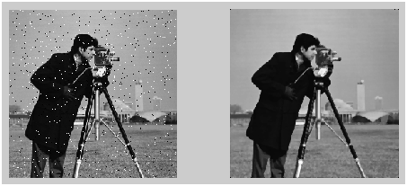
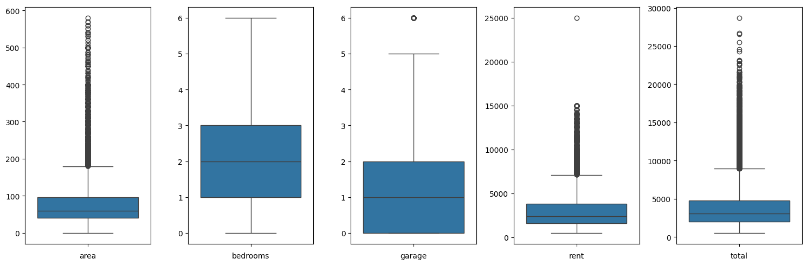
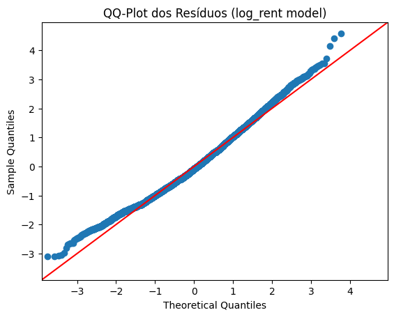
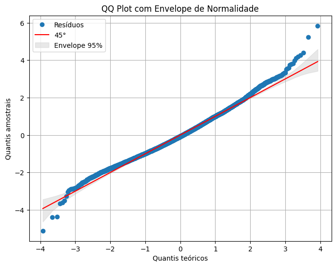
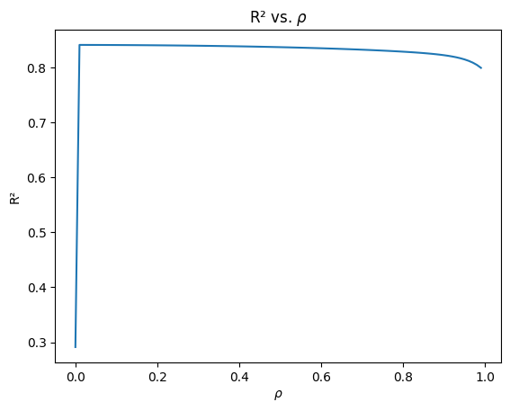
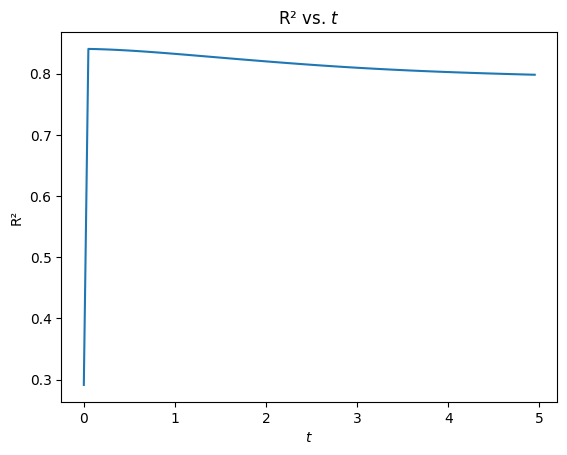
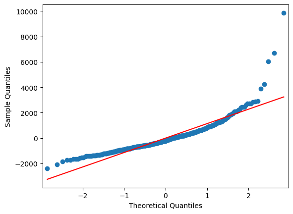
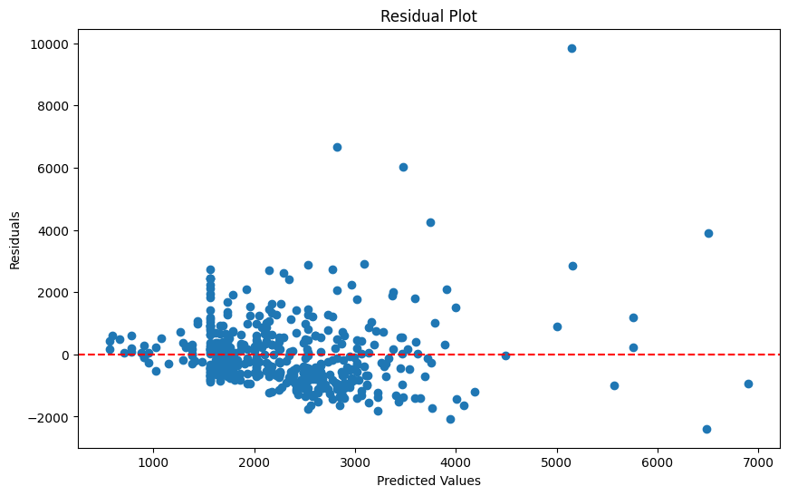

# Introdução 

Spatial Autoregression é um método desenvolvido na área de inferência como uma generalização da Autocorrelação para dados espaciais e é amplamente utilizado para processamento de dados geográficos.

Por outro lado, Graph Convolutional Networks (GCNs) são utilizadas para predição de dados estruturados por grafos. Inspiradas em Convolutional Neural Networks (CNNs), se baseam na operação de convolução para predizer informações sobre vértices, arestas ou o grafo inteiro. Recentemente, uma versão simplificada para GCNs chamada Simple Graph Convolutions foi proposta e será utilizada no desenvolvimento do trabalho.

Nesse trabalho, exploramos a conexão entre os dois métodos. Mostramos como Spatial Autoregression é uma aproximação linear de SGCs, providenciamos uma análise espectral do segundo método e realizamos a aplicação para predição de preços de casas em São Paulo.

# Metodologia

## Grafos

Grafos são utilizados para representar estruturas do mundo real. São formados por um conjunto de vértices e arestas. Vértices correlacionados são conectados por uma aresta. Grafos são tradicionalmente representados utilizando uma matriz de adjacência $A$. Vamos considerar a matriz $A$ simétrica, tal que o grafo é não-direcionado. O elemento $a_{ij}$ é 1 se houver uma aresta conectando $i$ e $j$ e 0 caso contrário.

A Laplaciana é uma matriz derivada da matriz de adjacências, definida como $L=D-A$, onde $D$ é a matriz de grau diagonal.

Para garantir a estabilidade numérica e uma correta normalização da difusão, utiliza-se a Laplaciana normalizada, $L_{norm} = I - D^{-1/2}AD^{-1/2}$.

## Modelo Linear

O modelo linear é expresso como $Y = X\beta + \epsilon$, onde $Y$ é o vetor da variável resposta, $X$ é a matriz de covariáveis (features), $\beta$ é o vetor de coeficientes a serem estimados e $\epsilon$ é o vetor de erros aleatórios.

## Teste $I$ de Moran

O teste de Moran é uma ferramenta para medir a espacialidade da variável resposta em função da matriz de adjacências do grafo.

$$
I = \dfrac{N}{\sum_{i,j} W_{ij}} \dfrac{y^T W y}{y^T y}
$$

Sob a hipótese nula de **não correlação espacial**, o valor esperado de $I$ é

$$
E(I)=\dfrac{-1}{N-1}
$$

Isso significa que para muitas amostras, o valor esperado tende a 0.

## Spatial Autoregression

Modelo Linear é a forma mais simples para regressão. Além das covariáveis, a relação entre os elementos do conjunto de dados podem possuir informações relevantes para a regressão. Considere a regressão do salário de um grupo de pessoas de acordo com sua escolaridade e idade. As variáveis são importantes, mas uma informação mais relevante é como essas pessoas se relacionam: ao considerar uma rede de amizade (*friendship network*), podemos obter resultados melhores.

Spatial Autoregression foi criada para sanar a dependência espacial em modelos lineares. O modelo é conhecido pela depedência espacial, mas qualquer conjunto de dados estruturados pode ser utilizado.

$$y_i = \sum_{j \in \text{vizinhos}}y_j w_{ij} + X_i\beta + \epsilon_i$$

Nesse modelos, os termos $w_{ij}$ representam a relação entre as amostras $i$ e $j$.

Para estimar o parâmetro $\beta$ devemos efetuar uma manipulação:

$Y=WY +X\beta + \epsilon$

$Y - WY=X\beta + \epsilon$

$Y(I - W)=X\beta + \epsilon$

$Y=(I - W)^{-1}(X\beta + \epsilon)$

Portanto, basta multiplicar $X$ pelo termo $(I - W)^{-1}$ e resolver o sistema linear resultante.

## Simple Graph Convolutions (SGCs)

No contexto de simplificação de modelos de GCN, removemos as não-linearidades para obter um modelo linear onde as propriedades dos nós são difundidas através do grafo e obtemos Simple Graph Convolutions (SGCs). O modelo final se assemelha a difusão das features utilizando a equação do calor.

A equação do calor é um caso especial da equação de difusão utilizada para descrever como o calor se distribui e flui ao longo do tempo.
Seja $x(t)_i$ a temperatura de $v_i$ no tempo $t$, a difusão de calor no grafo $G$ pode ser descrita pela seguinte equação do calor:

$$\frac{dx(t)_i}{dt} = -k \sum_j A_{ij} (x(t)_i - x(t)_j) = -k[D_{ii}x(t)_i - \sum_j A_{ij} x(t)_j]$$

A equação na forma matricial é $\frac{dX(t)}{dt} = -kLX(t)$. Para garantir a estabilidade e normalizar a difusão, utiliza-se a Laplaciana normalizada $L_{norm} = I - D^{-1/2}AD^{-1/2}$, que denotaremos por $L$ no restante desta seção. Reparametrizando $t$ e $k$ em um único termo $t' = kt$, a equação pode ser reescrita como:

$$\frac{dX(t')}{dt'} = -LX(t')$$

O **heat kernel** é a solução fundamental da equação do calor e é definido como a matriz 

$$H_t = e^{-Lt}$$

Dado o status inicial $X(0) = X$, a solução para a equação do calor pode ser escrita como:

$$X(t) = H_tX(0)$$

SGCs podem ser expressas como:

$$Y = H_t X W$$

onde $H_t = e^{-Lt}$ é o **heat kernel**, funcionando como a matriz de difusão que propaga as características iniciais $X$ (matriz de *features* dos nós) através da estrutura do grafo. $W$ é uma matriz de pesos treinável, aprendida pelo modelo - semelhante a $\beta$ no modelo linear.

## Equivalência entre Spatial Autoregression e SGCs 

Lembrando de séries para matrizes.

**Série Geométrica para Matrizes**: 
$$\sum_{k=0}^{\infty} A^k = (I - A)^{-1}$$

**Série de Maclaurin para Matrizes**:
$$e^A = \sum_{k=0}^{\infty} \frac{A^k}{k!} = I + A + \frac{A^2}{2!} + \frac{A^3}{3!} + \dots$$

Utilizando as séries, podemos escrever 

$$exp(-tL) = I - tL + \frac{t^2L^2}{2!} + \frac{t^3L^3}{3!} + \dots$$

Para $t \rightarrow 0$, podemos aproximar a série com

$$exp(-tL) \approx I - tL$$

Lembrando que a Laplaciana normalizada é $L=I-W$, temos:

$$exp(-tL) \approx I - t(I-W) = I - tI + tW$$

Por outro lado, também podemos reescrever o operador de Spatial Autoregression utilizando a série geométrica

$$(I - \rho W)^{-1} = I + \rho W + (\rho W)^2 + \dots$$

Para valores pequenos de $\rho$, aproximamos como

$$(I - \rho W)^{-1} \approx I + \rho W$$

A menos de um termo $tI$, para $\rho=t \rightarrow 0$, a regressão autoespacial é uma aproximação linear da difusão

$$exp(-tL) \approx (I-\rho W)^{-1}$$

## Espectro de Grafos e Filtros

Podemos analisar o espectro dos operadores sobre as features para uma melhor compreensão do efeito dos modelos. 
Em imagens, os filtros são utilizados para livrar-se de detalhes que não são importantes. 
O heat kernel atua de maneira semelhante sobre as *features* baseado na estrutura do grafo. 

### Decomposição de uma função polinomial sobre uma matriz

A decomposição espectral de uma matriz de adjacência $A^2$ é dada por

$$A^2 = U\Lambda U^{-1}U\Lambda U^{-1} = U\Lambda^2 U^{-1}$$

Podemos generalizar para qualquer potência $A^n$:

$$A^n = U\Lambda^n U^{-1}$$

Em geral, para qualquer função de matriz $f(A)$ que possui forma polinomial:

$$f(A) = h_0 A^0 + h_1 A^1 + h_2 A^2 + \dots + h_{N-1} A^{N-1}$$

a decomposição espectral é:

$$f(A) = Uf(\Lambda)U^{-1}$$

### Base de uma Transformada de Fourier como o caso especial dos autovetores da matriz de adjacências 

A transformada de Fourier é uma ferramenta para decompor um sinal em componentes fundamentais utilizando funções ortogonais. Para sinais contínuos, a transformada é uma soma infinita. Já no caso discreto, encontramos uma soma finita de vetores ortogonais que representa o sinal original. 

No processamento de sinais, diversos algoritmos - DFT, Wavelets - consideram que o sinal é cíclico: a última amostra $x(N-1)$ é procedida por $x(0)$. Assim, um sinal discreto pode ser representado por um grafo cíclico, onde cada vértice possui o valor do sinal no ponto correspondente e as arestas conectam pontos imediatamente vizinhos. A matriz de adjacência para esse caso é definida como: 

$$
A = \begin{pmatrix}
0 & 1 & 0 & \dots & 0 \\
0 & 0 & 1 & \dots & 0 \\
0 & 0 & 0 & \dots & 0 \\
\vdots & \vdots & \vdots & \ddots & \vdots \\
0 & 0 & 0 & \dots & 1 \\
1 & 0 & 0 & \dots & 0
\end{pmatrix}
$$

Autovalores e autovetores para a matriz $A$ são respectivamente definidos por $u_k$ e $\lambda_k$ em que $\mathbf{A} \mathbf{u}_k = \lambda_k \mathbf{u}_k$. Podemos reescrever a equação utilizando a matriz de adjacências do grafo cíclico para obter

$$
u_k(n - 1) = \lambda_k u_k(n)
$$

Onde $u_k(n)$ são os elementos do vetor $u_k$. Uma solução para essa equação é:

$$u_k(n) = \frac{1}{\sqrt{N}} e^{j2\pi nk/N} \text{ e } \lambda_k = e^{-j2\pi k/N}$$

para $k = 0, 1, \dots, N - 1$

Esses autovetores correspondem as bases de uma Transformada de Fourier Discreta nesse caso.

### Transformada de Fourier em Grafos

Tradicionalmente, sinais são frequentemente analisados e processados no domínio espectral. Essa abordagem também pode ser estendida a grafos. Representações no domínio espectral se baseiam na matriz de adjacências ou na Laplaciana. 

A Transformada de Fourier em Grafos (GFT) de um sinal $x$ é definida como:

$$X = U^{-1}x$$

Onde $U$ é uma matriz com os autovetores da matriz de adjacência (ou Laplaciana) em suas colunas. Assim, a Transformada de Fourier de Grafo pode ser entendida como uma decomposição de sinal no conjunto de autovetores como funções base ortonormais.

A Transformada Inversa de Fourier em Grafos (IGFT) é:

$$x = U X$$

### Ordem Espectral

Para estabelecer filtros em grafos, precisamos estabelecer uma **ordem espectral**. Isso significa que devemos definir autovetores que correspondem a variação lenta ou variação rápida.

Na análise de Fourier clássica, a base é ordenada de acordo com a frequência. A inspiração vem da análise de Fourier clássica. Nesse caso, em vez da frequência, utilizamos a energia da mudança do sinal como um indicador da velocidade de uma mudança de sinal no tempo.

A energia da mudança de um sinal (uma função base) $u(n)$ pode ser definida como a energia da primeira diferença:

$$E_{\Delta u} = \sum_{n=0}^{N-1} |u(n) - u(n - 1)|^2$$

Valores menores de $E_{\Delta u}$ significam que $u(n)$ varia lentamente. O valor $E_{\Delta u} = 0$ indica, na análise de sinal clássica, que o sinal é constante. Já valores grandes de $E_{\Delta u}$ estão associados a mudanças rápidas de sinal no tempo. 
Intuitivamente, isso faz sentido - funções mais homogêneas possuem energia 0. Já funções com maior variação possuem alta frequência. 

### Matriz Laplaciana

Podemos realizar a decomposição da Laplaciana. É evidente que os autovetores $u(n)$ com pequenas mudanças devem ter uma pequena energia cumulativa da diferença de segunda ordem $E_u = \sum_n((u(n)-u(n-1))^2 +(u(n)-u(n+1))^2)/2$. Este valor corresponde à forma quadrática do autovetor $u$ definida por $E_u = u^T L u$. Por definição,

$$Lu = \lambda u$$

e assim,

$$u^T L u = \lambda u^T u = \lambda = E_u$$

Os autovetores associados aos menores autovalores são de baixa frequência. A frequência aumenta de acordo com o autovalor.

### Filtros
Antes de apresentar filtros em grafos, relembramos como é a filtragem em imagens. Os filtros são utilizados para livrar-se de detalhes que não são importantes. Na imagem abaixo, frequência elevadas representam ruído e são filtradas utilizando a transformada de Fourier.

Para grafos, analisamos um filtro no domínio espectral. Um filtro passa-baixa ideal no domínio espectral da matriz de Laplaciana, com um autovalor de corte $\lambda_c$, é definido como:

$$f(\lambda) = \begin{cases} 1 & \text{para } \lambda < \lambda_c \\ 0 & \text{para outras } \lambda. \end{cases}$$

Como $f(L) = U f(\Lambda) U^T$, o **heat kernel** $H_t = e^{-Lt}$ também pode ser visto como um polinômio de $L$. Assim, seu filtro de kernel é $g(\lambda_i) = e^{-\lambda_i t}$. Os autovalores são positivos. 

Para quaisquer $i, j$, se $\lambda_i < \lambda_j$, temos

$$
\frac{f(\lambda_i)}{f(\lambda_j)} = e^{(\lambda_j-\lambda_i)t} > 1
$$

Assim,

$$
g(\lambda_i) > g(\lambda_j)
$$

Isso mostra que o Heat Kernel atua como um **filtro passa-baixa**. À medida que $t$ aumenta, a razão $e^{(\lambda_j-\lambda_i)t}$ também aumenta, atenuando cada vez mais as altas frequências. 

# Dataset

O conjunto de dados utilizado contém informações sobre aluguel de imóveis em São Paulo, Brasil. Os dados foram extraídos da plataforma QuintoAndar usando técnicas de web scraping em 1º de maio de 2023. O conjunto de dados inclui várias informações úteis, como o endereço do imóvel, o bairro, a área, o número de quartos, a disponibilidade de garagem, o preço mensal do aluguel, o tipo de imóvel e o custo total. Assim, o conjunto é uma fonte valiosa de informações para quem está interessado em analisar o mercado imobiliário em São Paulo.

# Resultados

## Modelo Linear
Após trabalhar com as varíaveis do dataset e analisar sua significância para o modelo, e utilizando VIF (Variance Inflation Factor) para testar a multicolinearidade entre elas, percebemos que o modelo linear alcançou uma performance ruim, indicada pelo coeficiente de determinação $R2=0.563$

Diagnosticamos o modelo utilizando QQ-Plot. Este plot mostra que os dados não seguem uma distribuição normal, mesmo após diversas tentativas de normalizar por meio de transformações nos dados. E com o QQ-Plot envelopado, percebemos que de fato menos de 95% dos dados estão fora do envelope, confirmando a não-normalidade dos dados.

| Statistic           | Value                |
| :------------------ | :------------------- |
| Dep. Variable       | $\log$ rent            |
| Model               | OLS                  |
| No. Observations | 459 |
| R-squared           | 0.563                |
| Prob (F-statistic)  | 0.00                 |

| Term               | coef    | std err | t         | $P>|t|$ | 
| :----------------- | :------ | :------ | :-------- | :------ |
| const              | 7.2700  | 0.006   | 1124.248  | 0.000   | 
| area               | 0.0057  | 0.000   | 54.590    | 0.000   |
| garage             | 0.2150  | 0.006   | 36.296    | 0.000   |
| Casa               | -0.3856 | 0.010   | -39.078   | 0.000   |
| Casa em condomínio | -0.2718 | 0.027   | -10.202   | 0.000   |

{ width=300px }

{ width=300px }

## Modelos Espaciais 

O teste I de Moran obteve um valor diferente de 0 para a matriz de adjacências normalizada: $I(W)=0.2$. Assim, podemos rejeitar a hipótese de não correlação espacial.

Em seguida, analisamos como o coeficiente de determinação do Modelo Linear tradicional se comporta ao adicionar a dependência espacial e variar o parâmetro $\rho$ e $t$. 

{ width=250px }

{ width=250px }

É possível observar que para $\rho=t=0$, o R2 é mínimo. Ao considerar interações espaciais $\rho=t \ne 0$, a performance do modelo aumenta.

Como demonstrado na seção de equivalência, para $\rho=t\approx 0$, os modelos são iguais. 
Assim, o sumário de suas regressões também é praticamente idêntico. 
Vamos utilizar $t=\rho=0.001$ para as análises. 
Semelhante ao modelo linear original, o QQ-Plot indica não normalidade.

| Statistic                   | Value                 |
| :-------------------------- | :-------------------- |
| **Dep. Variable** | rent                  |
| **Model** | OLS                   |
| **No. Observations** | 459                   |
| **R-squared (uncentered)** | 0.831                 |
| **Prob (F-statistic)** | 4.48e-171             |

| Term               | coef      | std err | t         | P>|t| | 
| :----------------- | :-------- | :------ | :-------- | :------ | 
| **const** | 733.2552  | 127.659 | 5.744     | 0.000   | 
| **area** | 25.6109   | 2.484   | 10.311    | 0.000   | 
| **garage** | 438.7155  | 95.088  | 4.614     | 0.000   |
| **Casa** | -960.9371 | 157.674 | -6.094    | 0.000   | 
| **Casa em condomínio** | -510.6751 | 404.941 | -1.261    | 0.208   | 
| **Studio e kitnet** | 461.9478  | 145.287 | 3.180     | 0.002   | 

\newpage

{ width=300px }

{ width=300px }

Como pudemos ver, apesar das transformações, o modelo linear não se adpatou muito bem a esses dados. Em comparação, utilizando o modelo espacial autorregresivo e de difusão, percebemos que aumenta em muito o grau de explicabilidade da variável resposta. Isso se dá ao fato do entendimento de que as casas ao redor também influenciam no preço do aluguel da casa alvo.

# Conclusão

Nesse trabalho foi possível aprofundar em adaptações do Modelo Linear para dados estruturados por grafos. Exploramos o efeito do filtro, a equivalência entre modelos e a eficiência ao aplicar num dataset real. Esperamos ver o modelo aplicado em dados geoespaciais ou outros datasets com grafos.

# Referências

- [Heat Kernel Graph Convolutions](https://openreview.net/forum?id=yBJihVXahXc)
- [Simplifying Graph Convolutions](https://arxiv.org/abs/1902.07153)
